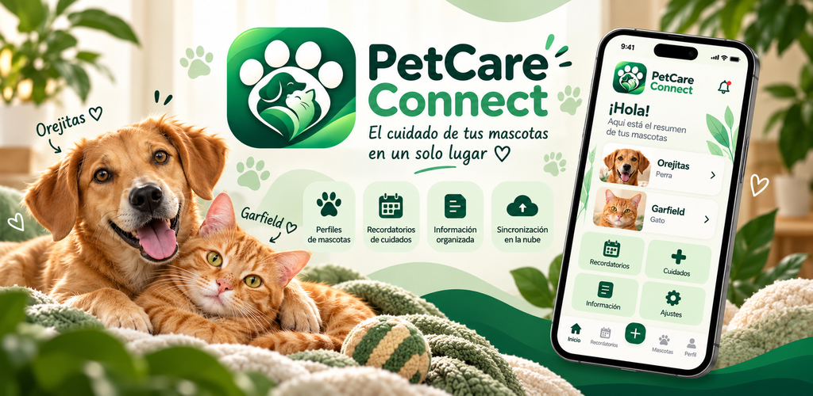

<div align="center">



# PetCare Connect

### Versión V45 · Android

Todo el cuidado de tus mascotas, en un solo lugar.

**Perfiles · Cuidados · Horarios · Recordatorios · Historial**

### [⬇ Descargar PetCare Connect V45](https://github.com/NMG15/PetCare-Connect/releases/tag/v0.21.16)

[Descargar APK directamente](https://github.com/NMG15/PetCare-Connect/releases/download/v0.21.16/PetCare_Connect_V45_PUNTOS_PRECISOS.apk) · [Ver publicaciones](https://github.com/NMG15/PetCare-Connect/releases)

</div>

---

## Novedades de V45

PetCare Connect organiza los cuidados de tus mascotas con una interfaz de tonos verde esmeralda, modo claro y modo oscuro.

| Función | Incluye |
| --- | --- |
| Mascotas y perfiles | Registro y edición de datos, fotografías y recorte de imágenes. |
| Cuidados | Registro de actividades y cuidados personalizados. |
| Agenda | Calendario y consulta de horarios con indicadores de próximos avisos. |
| Recordatorios | Configuración de horas y días por mascota. |
| Historial | Consulta de cuidados y exportación a PDF. |
| Administración | Herramientas según los permisos del usuario. |

### Mejoras de esta entrega

- Ajustes de navegación, rendimiento y estabilidad.
- Corrección de textos y caracteres especiales.
- Mejoras en horarios, calendario y avisos.
- Ajustes del historial, PDF y fotografías de perfil.

## Instalación y actualización

1. Entra en la [publicación oficial de V45](https://github.com/NMG15/PetCare-Connect/releases/tag/v0.21.16).
2. Descarga el archivo `PetCare_Connect_V45_PUNTOS_PRECISOS.apk` de **Assets**.
3. Instálalo en un teléfono Android compatible.
4. Si ya usas PetCare, actualiza **sin desinstalar** para conservar los datos locales, siempre que la firma sea compatible.

> Antes de actualizar, conserva una copia de seguridad de tus datos importantes. Los recordatorios dependen de los permisos de Android y de la configuración de batería.

## Comprobaciones de calidad

El proyecto fue revisado con el analizador de Flutter, pruebas automatizadas y el flujo de GitHub Actions. Los resultados detallados pueden consultarse en el historial de [Actions](https://github.com/NMG15/PetCare-Connect/actions) y los [Pull Requests](https://github.com/NMG15/PetCare-Connect/pulls?q=is%3Apr+is%3Aclosed).

Estas comprobaciones no sustituyen las pruebas manuales de todas las funciones, especialmente de servicios externos como Google Sign-In.

## Control de cambios y evaluaciones

- [Actualización funcional V45 (PR #14)](https://github.com/NMG15/PetCare-Connect/pull/14).
- [Actualización de documentación V45 (PR #15)](https://github.com/NMG15/PetCare-Connect/pull/15).
- [Seguimiento de mejoras V45](pruebas/V45/SEGUIMIENTO.md).

Las observaciones originales de los evaluadores deben conservarse como evidencias independientes; este README no las sustituye ni afirma que evaluaron la nueva versión.

## Tecnologías

Flutter · Dart · Android · Firebase Authentication · Cloud Firestore.

**Identificación técnica:** versión Android `0.21.16`, compilación `45`. El nombre de esta entrega es **V45**. No se cambia la numeración interna de la APK.

Para comprobar el código fuente:

```bash
flutter pub get
flutter analyze
flutter test
```

## Privacidad y seguridad

- [Política de privacidad](https://petcare-connect-67787.web.app/privacy.html)
- [Términos de uso](https://petcare-connect-67787.web.app/terms.html)
- [Eliminación de datos](https://petcare-connect-67787.web.app/delete-data.html)

Las contraseñas, las claves de firma y los registros técnicos privados **no deben publicarse**. El código fuente público no sustituye la configuración privada necesaria para instalar o administrar servicios.

---

<div align="center">

**PetCare Connect V45 · Proyecto académico · 2026**

</div>
